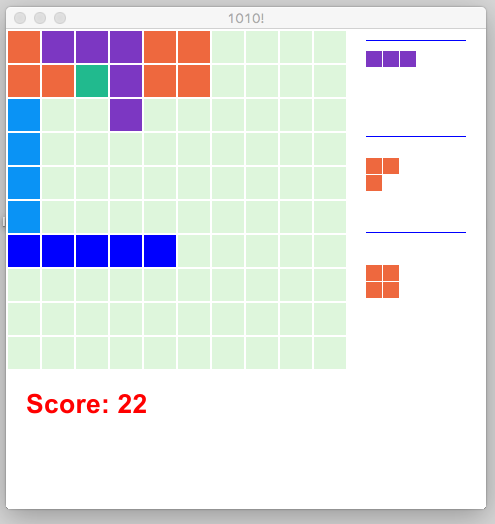

## Gosu based Board Game known as 1010!

[1010!] is a single player, tile-based, puzzle game produced by [Gram] Games, played on a square grid of 10x10 cells. The player is presented with a random selection of tile patterns of various shapes, 3 at a time, which are to be placed on the board, one by one. If the tiles consume an entire row (or column), without any empty cells in between, the row (or column) is cleared up so that more tiles can be placed. Each cell consumed by the tile counts towards the score of the game. The aim is to place as many tiles as possible to increase the score. In its most simplest form, each cell adds 1 point to the score. A variation of the game can be to assign different points for each color.

## Installation:

The game logic is written in [Ruby] (3.0 or newer) and the window uses the [Gosu] gem. Clone the code and install the gems:

```sh
$ git clone git@github.com:shanko/1010.git
$ cd 1010
$ bundle install
```

Gosu in turn has more dependencies and will require you to compile/install them as described [here]. Needs [gcc] or similar compiler.

**macOS with Homebrew:** Homebrew now installs `sdl2-compat` in place of `sdl2`, and its `sdl2-config` doesn't support the `--static-libs` option that gosu's build uses. Gosu then installs without errors but fails to load (`symbol not found ... _OBJC_CLASS_$_NSScreen` or `_SDL_GameControllerClose`). Pass the link flags yourself:

```sh
$ gem install gosu -v 1.4.6 -- --with-ldflags="-L/usr/local/lib -lSDL2 -framework Cocoa -framework AppKit"
```

(On Apple Silicon, Homebrew's libraries are in `/opt/homebrew/lib` instead of `/usr/local/lib`.)

**Training or benchmarking only (no game window):** gosu is in the Gemfile's
`gui` group, which `bundle install` includes by default. On a machine that only
runs `scripts/learn.rb`, `scripts/benchmark.rb` or `scripts/terminal_game.rb`,
skip it so gosu and its system libraries aren't needed:

```sh
$ bundle config set --local without gui
$ bundle install
```

The window tests are then skipped. To play in the window again, run
`bundle config unset --local without && bundle install`.

## Version:

1.0

## To play the game: 

```sh
$ ./1010
```

The `1010` launcher runs `bundle exec ruby scripts/game_1010.rb` and forwards
all command-line arguments. For example, `./1010 auto --seed 42`
starts an auto game with the default `learned` strategy. The evaluated model
is bundled at `models/learned.json`; no training is required. Use
`./1010 auto codex_sam --seed 42` for the strongest heuristic, or
`./1010 auto learned --model PATH` to load another learned model. Run it from the repository
directory, or put the repository directory on your `PATH` to use `1010` as a
command name.

Click on one of the tiles presented on the right side of the 10x10 grid (or press 1, 2 or 3). The tile will turn yellow indicating selection. Then click on one of the empty cells in the grid where you want to place the tile, or drag the tile there. Keep on adding tiles to the grid till one or more rows or columns fill up. Filled up rows and columns get emptied again making space for more tiles to be placed. The idea is to try and keep as many tiles as possible to increase the score. 

# Hints:

* Press and hold the H key to see help.
* Press and hold O to see Sam's suggested position for the selected tile.

| Key | Action |
|---|---|
| 1 / 2 / 3 | select a tile |
| O (hold) | show Sam's suggested position for the selected tile |
| U | undo the last move |
| N | new game |
| A | auto mode on/off |
| E | let the computer make one move |
| S | save the game (to `1010game.txt`; it is loaded again at the next start) |
| Q | save and quit |
| R | record a new game (press R again to stop) |
| P | play back the game recorded with R (without R, the most recent game in this window) |
| C | print where each tile fits (in the terminal) |
| ESC | quit without saving, and delete the saved game so the next start is a new game |

Saves store a compact snapshot using the same board and offer records as the
start of a new `.moves` trace. New traces use compact tile IDs (v3); v2 traces
with tile names and older verbose save files are still accepted.

## To play in the terminal:

```sh
$ bundle exec ruby scripts/terminal_game.rb
```

## To let the computer play the game:

```sh
$ ./1010 auto
$ ./1010 auto sam            # choose the strategy
$ ./1010 auto jc --seed 42   # the same games every time
$ ./1010 auto --games 10     # stop after 10 games and leave the last board up
$ ./1010 logs/20261030-123456-1234-567.moves # replay a logged game
```

To skip the window and animation, add `--headless`. It plays one game unless
you give `--games`, then exits, and does not need gosu:

```sh
$ ./1010 --headless                           # one game with the default player
$ ./1010 --headless sam --games 10 --seed 42  # the same games every time
```

It prints each game's score and log file, then the mean, minimum and maximum.
Every game is logged to `logs/`, so you can replay it in the window. It never
reads or changes your saved game, so its games match `./1010 auto sam --seed 42`
only when no saved game exists; the window continues a saved game first. To
compare strategies across many seeds, use
`scripts/benchmark.rb`, which reports paired results and writes no logs.

Auto mode prints one line when each game ends, then a run summary when you
quit. Run time excludes the half-second restart pause; total time includes it.

```text
Run 1   score 78   time 12.4s  new max
Run 2   score 66   time 9.8s
Run 3   score 122   time 18.1s  new max
Run 4   score 52   time 4.2s  unfinished
Runs: 3 completed, 1 unfinished   Max score: 122 (run 3)
Total time: 46.0s
```

Run all current auto strategies headlessly against the same seed list and save
a reproducible JSON benchmark report:

```sh
$ bundle exec ruby scripts/benchmark.rb --seeds 1..100 --output benchmarks/baseline-v1.json
```

Analyze a completed, replayable `.moves` trace and save a search lesson locally.
State and rollout limits make the work reproducible; `--budget` is only a safety
cap:

```sh
$ bundle exec ruby scripts/learn.rb analyze logs/<game>.moves --max-states 10000 --max-rollouts 8 --beam-width 8
```

Lessons are stored under the ignored `learning_data/` directory by default.
The command reports actual and candidate scores, the first action divergence,
and whether the search found an improvement. Search results are best-found
candidates, not proofs of an optimal sequence.

Improve a completed game while keeping its recorded tile sets in order. If the
trace has a seed, the command continues dealing from that seed after the logged
sets, so the extra sets are the ones the same game would have dealt. (A trace's
seed is the board's dealer seed, as recorded by the window and terminal games;
it is not a `benchmark.rb` session seed.) It writes a replayable
`.improved.moves` trace and a JSON report with the estimated cost of each
original move, listing the costliest first. Seedless traces use only their recorded
sets and report that limitation. Traces that ended with `quit` are refused. The
search uses a reproducible state budget; `--time` is an optional safety cap.

```sh
$ bundle exec ruby scripts/learn.rb improve logs/<game>.moves --states 50000
$ ./1010 --delay 0.5 logs/<game>.improved.moves
```

Add `--save-lesson` to store a lesson from the improved trace under
`learning_data/`.

For a deeper improvement pass, `scripts/deep_improve.rb` replays a recorded
prefix on the seeded dealer and re-searches the tail with a real rollout
budget — `learn.rb improve` caps rollouts at 100, which stops its beam near
depth 50 and cannot reach a ~200-move Game Over. The splice point decides how
much of the recorded game to keep; the search is deterministic per splice
point, so results vary with it. Every set after the splice is dealt on the
searched board, so a result is a game the seed could really deal. On one
recorded 930-point game, a mid-game splice scored 5,644 on the same seed, and
iterating late splices with `scripts/iterate_improve.rb` reached 18,781 before
gains tapered:

```sh
$ bundle exec ruby scripts/score_progression.rb logs/<game>.moves    # pick a splice point
$ bundle exec ruby scripts/deep_improve.rb logs/<game>.moves --prefix 140
$ bundle exec ruby scripts/iterate_improve.rb logs/<game>.improved.moves
```

`iterate_improve.rb` walks the splice fraction down after each failed round
(a fresh dice roll needs a different point) and keeps each strictly better
trace as the new base. Two smaller study utilities: `scripts/eval_seed.rb`
plays chosen strategies against a trace's exact dealer seed, and
`scripts/verify_trace.rb` replays traces and checks them against their
declared scores and seeded dealer.

Train a deterministic imitation model from completed, improved lessons whose
source seeds are in the training range. The trainer rejects held-out lessons,
and ignores incomplete or non-improving search results:

```sh
$ bundle exec ruby scripts/learn.rb train-imitation --lessons learning_data --seed 17 --epochs 20
```

If you have not accumulated replayable training games yet, generate seeded
episodes and complete search corrections directly into the ignored lesson
store. Start with a small range to inspect search yield before scaling up:

```sh
$ bundle exec ruby scripts/learn.rb collect-training --seeds 1000000..1000019 --max-states 2000 --max-rollouts 8
```

Evaluate a learned policy headlessly (a model is required):

```sh
$ bundle exec ruby scripts/benchmark.rb --seed-set held_out --strategies first_fit,last_fit,random_fit,shanko,jc,sam,codex_1,codex_sam,learned --model learning_data/models/imitation-v1.json --output learning_data/held-out.json
```

For a full learned-versus-heuristics report, include all eight heuristic strategies
and `learned`. The report records per-seed results, pairwise score differences,
95% confidence intervals, and the strongest heuristic by mean score. The held-out
seed set is for final reporting only; choose models with tuning seeds.

Compare an RL checkpoint directly with the tuning-selected policy in the same
report by adding `--comparison-model reinforcement=PATH`. This flag can be
repeated with distinct names. Each model receives the same seeds; the report
includes every pairwise score difference, model fingerprints, score distributions
and game lengths. Models and reports remain under ignored `learning_data/`.
Add `--workers 4` to use four evaluation processes on macOS/Linux. Parallel
evaluation preserves the serial seed order and results; the default is one
process.

See [the full learning evaluation](docs/learning_evaluation.md) for the milestone
audit, model-selection outcome, held-out comparison and reproduction commands.
For repeated lesson collection, imitation training, resumable RL sessions and
tuning comparisons, follow [the training workflow](docs/training_workflow.md).

Start the graphical learned auto-player with the tuning-selected checkpoint:

```sh
$ ./1010 auto learned --model learning_data/checkpoints/selected.json --seed 42
```

The simulator and benchmark support learned models now. To collect search
corrections from states visited by the learned policy, use training seeds only:

```sh
$ bundle exec ruby scripts/learn.rb correct --model learning_data/models/imitation-v1.json --seeds 1000000,1000001 --max-states 2000 --max-rollouts 1 --stride 5
```

Fine-tune an imitation model with REINFORCE on complete training-seed games.
The default tuning sample uses the first 20 tuning seeds. Each evaluated
checkpoint is retained; `selected.json` points to the candidate with the best
tuning mean. Checkpoints are evaluated every 10 episodes by default, and also
after the final episode. REINFORCE uses raw board-area returns with a rolling
baseline; the default learning rate is `0.01`, so lower it if updates are too
large for a particular model. Resume from a checkpoint to continue its training state:

```sh
$ bundle exec ruby scripts/learn.rb train-rl --model learning_data/models/imitation-v1.json --episodes 10 --seed 17
$ bundle exec ruby scripts/learn.rb train-rl --resume learning_data/checkpoints/selected.json --episodes 10 --seed 17
```

The `train-rl` JSON output lists every checkpoint path. Training replaces
`selected.json` only when the candidate has a strictly higher tuning mean on
the same tuning seed list; it rescans the prior selection if the lists differ.
Use `scripts/learn.rb select` when you deliberately want to override that
automatic selection.

Use the selected checkpoint pointer directly for headless evaluation with
`scripts/benchmark.rb --model learning_data/checkpoints/selected.json`.
To reselect a retained checkpoint, evaluate it on tuning seeds first:

```sh
$ bundle exec ruby scripts/learn.rb select --checkpoint learning_data/checkpoints/reinforce-step-100-20261030T054859123456Z.json
```

Action feature version 2 records tile area and one-hot tile type, rows and
columns cleared, remaining legal placements, largest four-neighbor empty
region, empty-region count, isolated eight-neighbor empty cells, filled
neighbors, touched edges, and resulting occupied fraction. For every legal
candidate, the extractor combines its tile and anchor context with simulated
post-placement board features. The linear scorer uses deterministic seeded
tie-breaking.

Feature version 1 models must be retrained before use with the current code.
Use `train-imitation --output learning_data/models/imitation-v2.json` to retain
the older model while producing a compatible one.

Pass a `.moves` file as the command line argument to replay it. Current v3 traces
and existing v2 traces can be replayed. Moves are shown in order, with 0.5
seconds between successive moves by default. Set another interval in seconds
with `--delay` (for example, `--delay 2`):

```sh
$ ./1010 --delay 2 logs/<game>.moves
```

Try defeating the computer (it is very hard) by taking turns and comparing the score AND time required to play it.

The strategies are in `lib/auto_player.rb`: `first_fit`, `last_fit`, `random_fit`, `shanko`, `jc`, `sam`, `codex_1`, `codex_sam` and `learned` (the default). Learned uses the stronger-teacher model from #33 with wall preference calibrated from a 1,184-point manual game. On 2,000 new test seeds it gains +43.62 over the previous learned release (95% CI +31.53 to +55.70), and +83.86 over Codex Sam (95% CI +72.75 to +94.96). See [the study](docs/best_score_study.md). Codex Sam is the strongest heuristic: on 1,000 tuning seeds it averaged 326.40 against Sam's 287.46 (paired +38.94, 95% CI +27.76 to +50.13). Search, lesson analysis and `improve` still use Sam for their many rollout games, because it is about six times faster. Codex 1 chooses a tile and placement that preserve the most legal placements for the remaining tiles in the current offer. Codex Sam uses Codex 1 to choose the tile, then Sam to choose its placement. Sam scores completed lines first, then footprint contact, falling back to JC's choice on a tie. With `--seed` the computer gets the same tiles and makes the same choices every run, so strategies can be compared fairly.

## Code:

* `lib/board.rb`: the rules (placing tiles, clearing lines, dealing, saving), with no input or output
* `lib/auto_player.rb`: the computer player and its strategies
* `lib/move_animation.rb`: shows a move square by square without pausing the window
* `lib/game_log.rb` / `lib/game_trace.rb`: write, validate and replay versioned game traces with initial state, exact offers, moves, undos and final score
* `lib/offer_replay.rb`: the one replayer for recorded moves and offer batches, used by traces, lessons, the simulator, imitation training and window playback
* `lib/game_simulator.rb`: runs full games without Gosu for policy evaluation
* `lib/game_session.rb`: Gosu-free game state, moves, undo, auto runs, playback and save rules
* `lib/game_options.rb`: parses window command-line arguments without Gosu
* `lib/improvement_search.rb`: searches for better legal game sequences under explicit time, state, and beam limits
* `lib/lesson_analyzer.rb` / `lib/lesson_store.rb`: analyze completed traces and persist reproducible, versioned lessons
* `lib/lesson_collector.rb`: generate complete improved lessons from reproducible training seeds
* `lib/learned_player.rb`: versioned action features, linear policy, and deterministic imitation training
* `lib/policy_corrector.rb`: searches continuations from states visited by a learned policy
* `lib/reinforcement_trainer.rb`: REINFORCE training, resumable checkpoints, and tuning-based selection
* `lib/learning_seed_sets.rb` / `scripts/benchmark.rb`: define disjoint seed sets and generate reproducible strategy benchmarks
* `scripts/game_1010.rb`: the Gosu window entry point (drawing and input), backed by `GameSession`; use `./1010` to launch it
* `scripts/terminal_game.rb`: the terminal version
* `scripts/learn.rb`, `scripts/benchmark.rb` and the other files in `scripts/`: runnable command-line tools

## Tests:

```sh
$ bundle exec rake test
```

## License: 

MIT

## Screen shot:



## To Do:

* Rewrite using [graphics] gem
* ~~Make "auto" mode repeatable by passing a seed to random num generator~~ (`--seed`)
* Save History (games can be recorded and played back with R and P, but recordings aren't saved to a file yet)
* Use repeatable history to compare "auto" mode algorithms
* Improve "auto" mode algorithms to maximize score
* Port to use [mruby]
* Machine learning
* Weighted scoring based on color or shapes
* Leader Board

[//]: # (These are reference links used in the body of this note and get stripped out when the markdown processor does its job. There is no need to format nicely because it shouldn't be seen. Thanks SO - http://stackoverflow.com/questions/4823468/store-comments-in-markdown-syntax)

  [1010!]: <http://web.eecs.umich.edu/~gameprof/gamewiki/index.php/1010!>
  [Ruby]: <http://ruby-lang.org>
  [Gosu]: <https://www.libgosu.org>
  [here]: <http://libgosu.org>
  [gcc]: <http://gcc.gnu.org>
  [Gram]: <http://gram.gs/game-detail-1010.html>
  [mruby]: <http://mruby.org>
  [graphics]: <https://github.com/seattlerb/graphics>
